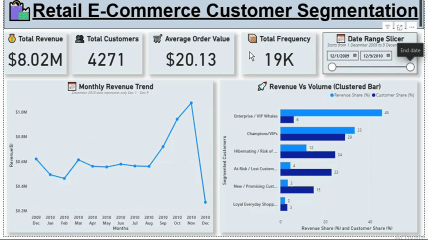

 

### Project Overview
An end-to-end ML customer segmentation engine utilizing a hybrid "**Cluster-Then-Predict**" (K-Means + Random Forest) architecture to drive a projected **10.01% revenue uplift**. Features an automated RFM feature engineering backend, a low-latency live Streamlit web UI, and an enterprise Power BI reporting layer built.

## 💡 The Vision: Why this exists
Retailers bleed money by treating all customers equally. Sending a 20% discount to a VIP who was going to buy anyway destroys profit margins, while ignoring a fading loyalist guarantees silent churn. 

This project is an intelligent end-to-end segmentation engine. It analyzes historical e-commerce buying habits using Recency, Frequency, and Monetary (RFM) metrics, automatically groups customers via Machine Learning algorithms (K-Means/Random Forest), and feeds those actionable personas into an enterprise reporting layer.

This dashboard goes beyond data visualization to act as a strategic decision-making engine. By executing the phased marketing recommendations generated by the model, businesses can achieve a projected **10.01% uplift in revenue**.

## 📈 Strategic Business Impact
This architecture goes beyond data visualization to act as a strategic decision-making engine. By translating machine learning segments into actionable marketing interventions, this application empowers stakeholders to make data-driven decisions, yielding a projected **10.01% increase in overall monthly revenue**.

**The December Playbook Overview:**

* **Phase 1 (Dec 10-20):** Maximizes peak holiday volume by deploying white-glove service to *Enterprise Whales* (who drive 43.7% of revenue) and aggressively upselling *Champions*.
* **Phase 2 (Dec 21-31):** Executes post-holiday inventory liquidation by targeting price-sensitive *New Customers*, while strictly protecting the profit margins of higher-tier segments.

## 🔬 The Technical Edge: "Cluster-Then-Predict" Architecture
Most standard portfolios deploy brittle, distance-based unsupervised models (like K-Means) directly to production. Those are computationally heavy and easily broken by high-value extreme outliers. 

This project utilizes a highly scalable, **two-stage MLOps architecture**:

1. **Offline Discovery (Unsupervised + Heuristics):** Historical RFM data was log-transformed, standard-scaled, and clustered using K-Means. Mathematical centroids were then combined with strict, visually verified business-logic rules to safely isolate outliers and generate highly accurate ground-truth labels.
2. **Production Inference (Supervised RF):** A Random Forest Classifier (RFC) was trained to learn these complex, non-linear segment boundaries. 
3. **The Deployment Advantage:** Because tree-based models are natively immune to outliers, the live Streamlit dashboard **bypasses clunky feature scaling entirely**. It processes raw user inputs instantly to deliver lightning-fast, real-time segment predictions.

### 🏗️ End-to-End System Architecture

### 1. The Machine Learning Backend (Python)
* **ETL Pipeline:** Extracted and cleaned the UCI Online Retail dataset (Dec 2009–Dec 2010), handling missing values and scaling variables.
* **Clustering:** Deployed K-Means clustering to logically separate the customer base, mapping output labels to actionable business personas (e.g., *Champions*, *At-Risk*, *Whales*).

### 2. The Interactive Web App (Streamlit)
* Built a dynamic front-end using Streamlit to allow data scientists and product managers to test the underlying RFM logic, view segment distributions, and interact with the Python prediction models in real-time.
```text
[Raw Transactions] ➔ [RFM Feature Engineering] ➔ [K-Means + Visual Heuristics] ➔ [Labeled Dataset]
                                                                                        ↓
                     [Model Artifact: rfc.joblib] ⟵ [Random Forest Classifier] ⟵ [Labeled Training]
                                  ↓
[Streamlit UI] ➔ [Live Raw RFM Input] ➔ [RFC Inference Engine] ➔ [Targeted Marketing Strategy]
```

### 3. The Enterprise Reporting Layer (Power BI)
* **Data Modeling:** Constructed a Star Schema connecting a central `Fact_Transactions` table with `Dim_Customers` and `Dim_Calendar` to mirror corporate Data Warehousing standards.
* **Executive Dashboard:** Built a dynamic, 3-page Power BI report (`.pbix` file included in this repository) featuring AI decomposition trees and an exportable CRM targeting ledger for the marketing team to execute the Phase 1 and 2 email campaigns.

## 🖥️ Dashboard Features
* 📊 **Analytics:** Track overarching business **KPIs** (Total Revenue, Unique Customers, Average Basket Value).

* 🤖 **RFM Clustering:** Analyze offline cluster centroids and 3D **behavioral distribution** maps.

* 🔍 **Robust Inference Engine:** This Segmentation Dashboard can **identify hidden** customer behavior & also can deal with **outlier customers**

* **Low Latency:** The architecture is **fast** because it makes an intentional trade-off by **heavy math happens offline, simple math happens online**.

* 🔍 **Customer Lookup:** Search individual **user profiles** to extract raw transactional ledgers and micro-patterns.

* 🔮 **ML Classification:** A live inference simulator. Input raw RFM values to instantly predict a customer's persona using the pre-trained **Random Forest engine**.

* ⚙️ **Building Process:** A transparent look into the **data engineering and algorithmic decisions** behind the platform.
