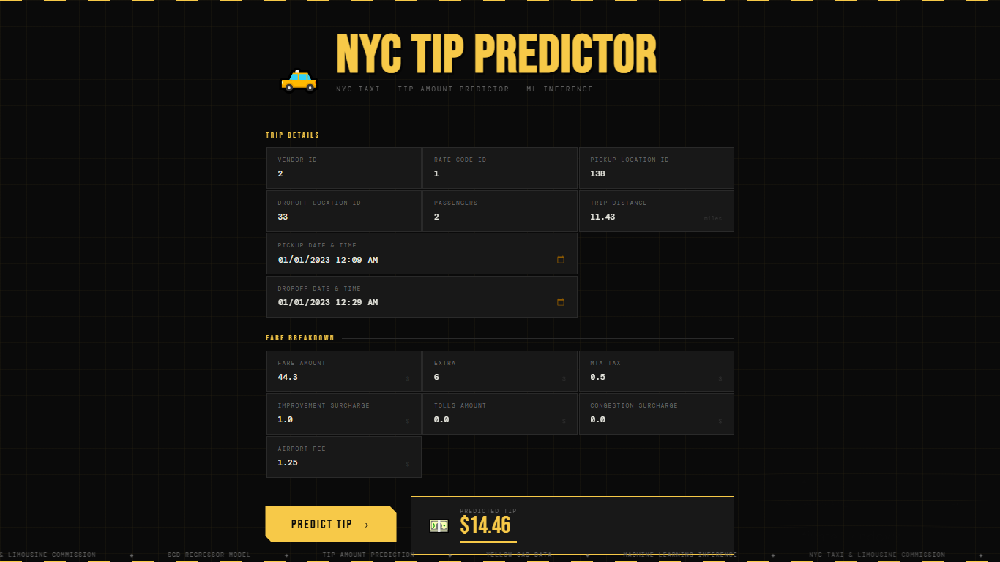

 

## Project Overview
The NYC Taxi Tip Predictor is an end-to-end machine learning pipeline that predicts passenger tip amounts using historical NYC TLC data. Built to transition ride-share drivers from guesswork to a data-driven strategy, this system predicts high-yield zones and times to help drivers maximize their hourly earnings.

### 🚨 Problem Statement

For ride-share and taxi drivers, the base fare covers the operational costs of the vehicle, but the **tip amount dictates their actual profit**. However, tipping behavior is highly volatile and unpredictable. Currently, drivers rely on intuition or simply chase high-volume areas, which often results in wasted fuel and time waiting for rides that yield poor tips. 

This lack of actionable foresight creates specific pain points for two main groups:
* **For Drivers (Inefficiency):** Drivers cannot easily identify which specific zones, times, or effective routes will yield the highest return on their time. They need data to know where to wait.
* **For Customers (Static Tipping):** Customers are often prompted with rigid, static tip suggestions (e.g., 20%, 25%, 30%). Predicting an expected tip amount provides a dynamic, context-aware baseline that can help customers decide on a fair tip based on historical norms for that specific route and time.

**The Solution:** 

This project introduces a predictive machine learning pipeline that shifts strategy from a reactive "guessing game" to a proactive, data-driven approach. By forecasting the exact tip amount based on spatial (pickup/drop-off zones) and temporal (time, day, rush hour) factors, this system empowers drivers to strategically position themselves in high-yield scenarios while offering transparent tip estimates for riders.

## 🚀 Objectives

This portfolio piece was built to demonstrate a complete, end-to-end Machine Learning lifecycle, specifically focusing on:

- **Business Value:** Enables drivers and fleet managers to optimize routes and shift schedules based on predicted ROI rather than just ride volume, while also helping customers determine a fair tip amount based on historical data.
- **Advanced Feature Extraction:** Extract meaningful insights from large volumes of data.  
- **End to End MLOps:** Automates the complete ML lifecycle—from raw data ingestion and feature engineering to model training and evaluation.
- **Production-Ready:** Features a fully containerized deployment, ensuring the model is scalable, reproducible, and easily updated.
- **Experiment Tracking:** Logging model hyperparameters, artifacts, and metrics (achieving a **$1.22 MAE**) using **MLflow** and **DagsHub**.
- **Real-Time Inference Serving:** Wrapping the trained model in a fully functional, styled **Flask** web application that instantly translates user input into actionable financial predictions.

## 🔄 Development Workflow

This project strictly adheres to a modular design pattern. To experiment with the pipeline or add new features, follow this standard sequence:

1. Update `config.yaml` (paths/directories) and `params.yaml` (model hyperparameters).
2. Define data structures in the `entity` module.
3. Update the `ConfigurationManager` within `src/config`.
4. Modify the relevant pipeline `components` (e.g., ingestion, transformation, training).
5. Integrate the updated components into the specific `pipeline` script.
6. Register the pipeline in `main.py` and update `dvc.yaml` to track the new execution graph.
7. Serve the updated model via the `app.py` Flask interface.

## 🏗️ System Architecture

This project is built using a modular, component-based architecture orchestrated by **DVC (Data Version Control)**. 

1. **Data Ingestion:** Automatically fetches and extracts the NYC Taxi dataset.
2. **Data Validation:** Enforces schema rules and generates a validation status. Acts as a "Circuit Breaker" to halt the pipeline if anomalous data is detected.
3. **Data Transformation:** Handles complex feature engineering:
   * Datetime extraction (weekend flags, AM/PM, trip duration).
   * Cyclical encoding for pickup hours using sine/cosine transformations.
   * Spatial feature engineering (airport zone mapping).
   * Target Encoding and Standard Scaling (saved as `preprocessor.pkl` to prevent data leakage during inference).
4. **Model Training:** Trains an SGD Regressor, logging hyperparameters (alpha, penalty) to **MLflow** via DagsHub.
5. **Model Evaluation:** Calculates regression metrics (RMSE, MAE, R2) and saves them to `evaluation.json`.
6. **Inference Pipeline:** A dedicated prediction engine wrapped in a **Flask** web application for real-time user predictions.