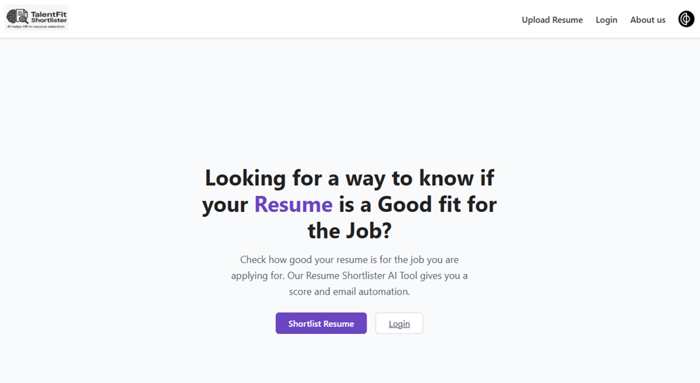

 

## Project Overview
In today’s fast-paced recruitment environment, Human Resource (HR) professionals face the challenge of manually screening large volumes of resumes—a process that is both time-consuming and inefficient.

**TalentFit Shortlister** is an intelligent, automated resume shortlisting web application. By leveraging Natural Language Processing (NLP) and machine learning-based similarity models, the system accurately matches bulk uploaded candidate resumes against a target Job Description (JD) **without manual intervention**. It closes the recruitment loop by **automatically emailing** the top-ranked candidates.

### 🎯 The Core Problem & Solution
* **The Problem**: Traditional ATS (Applicant Tracking Systems) often rely on rigid keyword matching, rejecting highly qualified candidates, while manual screening suffers from human fatigue and bias.
* **The Solution**: A dual-engine machine learning approach. By combining keyword analysis with deep semantic understanding, TalentFit Shortlister ensures that candidates who have the right skills—even if phrased differently—are accurately evaluated, ranked, and contacted.

### ✨ Key Features
* **Bulk PDF Parsing:** Seamlessly extract and clean textual content from multiple uploaded PDF resumes using `pdfminer`.
* **Dual-Engine Similarity Scoring:** 
  * **TF-IDF (Term Frequency-Inverse Document Frequency):** Ensures essential industry keywords and hard skills from the JD are present in the resume.
  * **BERT (Bidirectional Encoder Representations from Transformers):** Provides deep, semantic-level understanding of the resume's context, evaluating the actual meaning behind a candidate's experience.
* **Interactive HR Dashboard:** A React.js frontend that visually presents ranked candidates alongside their match percentages, allowing HR personnel to select top choices via simple checkboxes.
* **Automated Email Outreach:** Utilizes Regular Expressions (RegEx) to extract contact details from selected PDFs and automatically dispatches interview invitations via SMTP integration.

### 🧠 System Architecture & Workflow
1. **Input:** HR uploads a batch of candidate PDFs and pastes the target Job Description into the React interface.
2. **Extraction:** The backend parses the PDFs into raw text strings.
3. **NLP Processing:** Both TF-IDF and BERT models compute cosine similarity scores between each resume and the JD.
4. **Ranking:** Resumes are ordered by their similarity scores and returned to the frontend.
5. **Automation:** Upon HR selection, the backend extracts candidate emails and triggers SMTP notifications.
